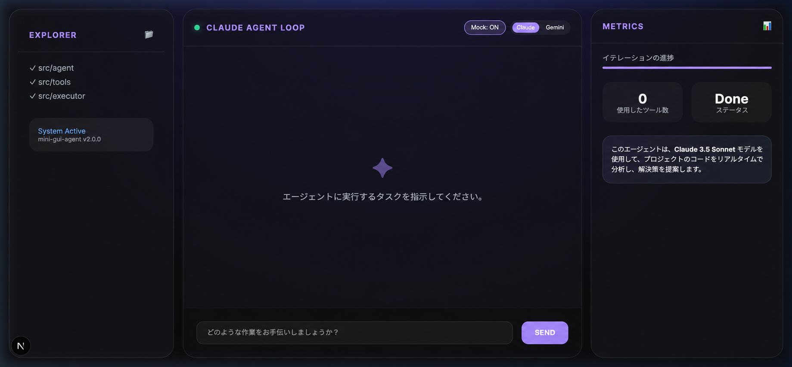

# ✦ Mini-GUI-Agent: AI Engineering Dashboard

[日本語](README.ja.md) · [English](README.md) · [한국어](README.ko.md)

モダンで美しくデザインされたダッシュボードを使用して、**Claude**と**Google Gemini**ベースのAIエージェントループを管理および監視できるプロジェクトです。



## 🚀主な特長

- **Dual-Model Support**: Anthropic Claude と Google Gemini の両方をサポートします。ボタン1つでエージェントエンジンを切り替えることができます。
- **Agent Intelligence**：特定のタスクを実行するために、ディレクトリ分析、ファイルの読み取り/書き込み、命令の実行など、さまざまなツール（Function Calling）を使用します。
- **Modern Dashboard UI**: 思考過程(Thought)、ツール実行(Tool Use)、結果(Result)をリアルタイムで視覚化し、エージェントのワークフローを一目で把握できます。
- **Mock Mode サポート**: API キーなしでエージェントの動作をテストできるシナリオベースのシミュレーションモードを提供します。
- **Metrics & Logging**: ツール使用回数、状態進行度、詳細実行ログをリアルタイムで確認可能です。

## 🛠️ 技術スタック

- **Frontend/Backend**: Next.js (App Router), React, TypeScript
- **Styling**: Vanilla CSS (Modern Aesthetics)
- **AI SDK**: @anthropic-ai/sdk, @google/generative-ai
- **Tools**: Zod、Zod-to-JSON-Schema

## 🔧 ツールバー (Agent Tools)

エージェントは、次のツールを組み合わせて複雑なエンジニアリングタスクを実行します。
- `list_dir`: ディレクトリ構造の確認
- `read_file` / `write_file`: ファイル内容の読み書き
- `edit_file`：ファイルの特定部分の修正（Linterベースの補正を含む）
- `run_command`: 端子命令実行
- `search_code`: コードベース内検索
- `glob`：パターンベースのファイルナビゲーション

## 🏁 はじめに

### 1. 環境変数の設定
`.env.local`ファイル（またはシステムホスト環境）に次のAPIキーを設定してください。

```bash
ANTHROPIC_API_KEY=your_anthropic_key
GEMINI_API_KEY=your_gemini_key
```

### 2. パッケージのインストール
```bash
npm install
```

### 3. 開発サーバーの実行
```bash
npm run dev
```
その後、`http://localhost:3000`に接続してダッシュボードを確認してください。

## 📁 プロジェクト構造

- `app/`: Next.js ページとレイアウト (Dashboard UI)
- `src/agent/`：エージェントループとモデル別ラッパー（Claude、Gemini、Mock）
- `src/executor/`: ツールの実行とスキーマ変換 (ToolExecutor)
- `src/tools/`：個々のツール実装
- `lib/`: サーバーサイドエージェントランナー
