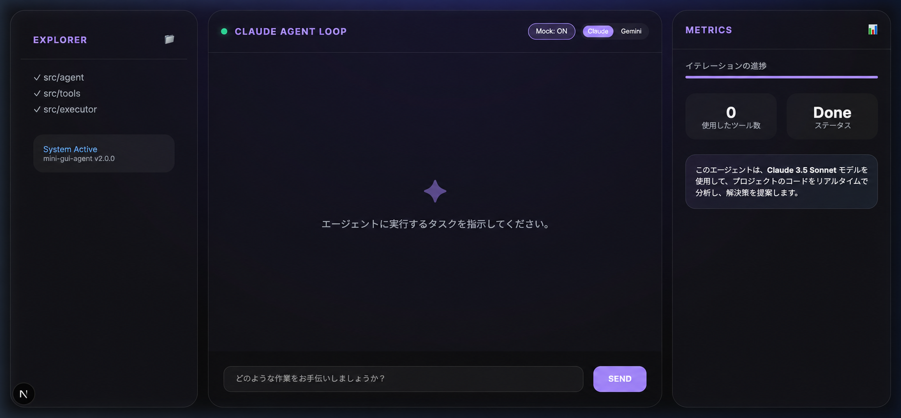
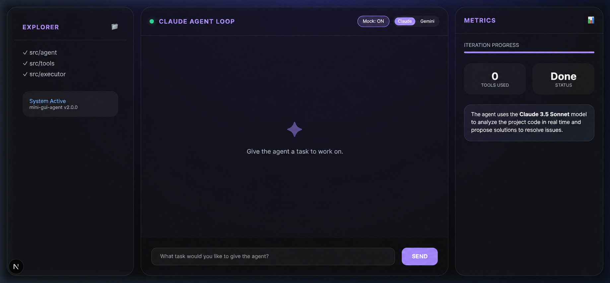
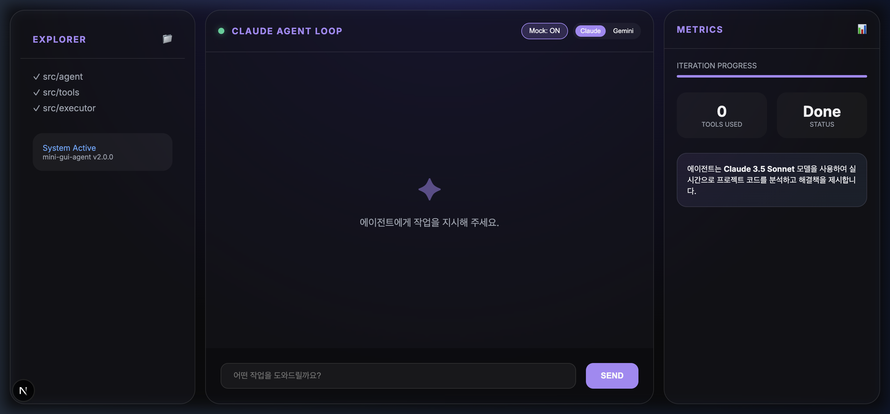

# ✦ Mini-GUI-Agent: AI Engineering Dashboard

[日本語](https://github.com/hjy0221/mini_GUI_agent#%E6%97%A5%E6%9C%AC%E8%AA%9E) · [English](https://github.com/hjy0221/mini_GUI_agent#english) · [한국어](https://github.com/hjy0221/mini_GUI_agent#%ED%95%9C%EA%B5%AD%EC%96%B4)

## 日本語

[日本語](https://github.com/hjy0221/mini_GUI_agent#%E6%97%A5%E6%9C%AC%E8%AA%9E) · [English](https://github.com/hjy0221/mini_GUI_agent#english) · [한국어](https://github.com/hjy0221/mini_GUI_agent#%ED%95%9C%EA%B5%AD%EC%96%B4)

モダンで美しくデザインされたダッシュボードを使用して、**Claude**と**Google Gemini**ベースのAIエージェントループを管理および監視できるプロジェクトです。



## 🚀主な特長

- **Dual-Model Support**: Anthropic Claude と Google Gemini の両方をサポートします。ボタン1つでエージェントエンジンを切り替えることができます。
- **Agent Intelligence**：特定のタスクを実行するために、ディレクトリ分析、ファイルの読み取り/書き込み、命令の実行など、さまざまなツール（Function Calling）を使用します。
- **Modern Dashboard UI**: 思考過程(Thought)、ツール実行(Tool Use)、結果(Result)をリアルタイムで視覚化し、エージェントのワークフローを一目で把握できます。
- **Mock Mode サポート**: API キーなしでエージェントの動作をテストできるシナリオベースのシミュレーションモードを提供します。
- **Metrics & Logging**: ツール使用回数、状態進行度、詳細実行ログをリアルタイムで確認可能です。

## 🛠️ 技術スタック

- **Frontend/Backend**: Next.js (App Router), React, TypeScript
- **Styling**: Vanilla CSS (Modern Aesthetics)
- **AI SDK**: @anthropic-ai/sdk, @google/generative-ai
- **Tools**: Zod、Zod-to-JSON-Schema

## 🔧 ツールバー (Agent Tools)

エージェントは、次のツールを組み合わせて複雑なエンジニアリングタスクを実行します。
- `list_dir`: ディレクトリ構造の確認
- `read_file` / `write_file`: ファイル内容の読み書き
- `edit_file`：ファイルの特定部分の修正（Linterベースの補正を含む）
- `run_command`: 端子命令実行
- `search_code`: コードベース内検索
- `glob`：パターンベースのファイルナビゲーション

## 🏁 はじめに

### 1. 環境変数の設定
`.env.local`ファイル（またはシステムホスト環境）に次のAPIキーを設定してください。

```bash
ANTHROPIC_API_KEY=your_anthropic_key
GEMINI_API_KEY=your_gemini_key
```

### 2. パッケージのインストール
```bash
npm install
```

### 3. 開発サーバーの実行
```bash
npm run dev
```
その後、`http://localhost:3000`に接続してダッシュボードを確認してください。

## 📁 プロジェクト構造

- `app/`: Next.js ページとレイアウト (Dashboard UI)
- `src/agent/`：エージェントループとモデル別ラッパー（Claude、Gemini、Mock）
- `src/executor/`: ツールの実行とスキーマ変換 (ToolExecutor)
- `src/tools/`：個々のツール実装
- `lib/`: サーバーサイドエージェントランナー

## English

[日本語](https://github.com/hjy0221/mini_GUI_agent#%E6%97%A5%E6%9C%AC%E8%AA%9E) · [English](https://github.com/hjy0221/mini_GUI_agent#english) · [한국어](https://github.com/hjy0221/mini_GUI_agent#%ED%95%9C%EA%B5%AD%EC%96%B4)

This is a project that allows you to manage and monitor AI agent loops based on **Claude** and **Google Gemini** through a modern and elegantly designed dashboard.



## 🚀 Key Features

- **Dual-Model Support**: Supports both Anthropic Claude and Google Gemini. You can switch agent engines with one button.
- **Agent Intelligence**: Uses various tools (Function Calling) such as directory analysis, file reading/writing, and command execution to perform a given task.
- **Modern Dashboard UI**: You can understand the agent's workflow at a glance by visualizing thought process (Thought), tool execution (Tool Use), and result (Result) in real time.
- **Mock Mode Support**: Provides a scenario-based simulation mode that allows you to test how the agent behaves without an API key.
- **Metrics & Logging**: You can check the number of tool uses, status progress, and detailed execution logs in real time.

## 🛠️ Technology Stack

- **Frontend/Backend**: Next.js (App Router), React, TypeScript
- **Styling**: Vanilla CSS (Modern Aesthetics)
- **AI SDK**: @anthropic-ai/sdk, @google/generative-ai
- **Tools**: Zod, Zod-to-JSON-Schema

## 🔧 Toolbar (Agent Tools)

Agents perform complex engineering tasks using a combination of the following tools:
- `list_dir`: Check directory structure
- `read_file` / `write_file`: Read and write file contents
- `edit_file`: Modify specific parts of the file (including linter-based correction)
- `run_command`: Execute terminal command
- `search_code`: Search within the codebase
- `glob`: Pattern-based file exploration

## 🏁 Get started

### 1. Setting environment variables
Please set the following API keys in the `.env.local` file (or system host environment).

```bash
ANTHROPIC_API_KEY=your_anthropic_key
GEMINI_API_KEY=your_gemini_key
```

### 2. Package installation
```bash
npm install
```

### 3. Run the development server
```bash
npm run dev
```
Afterwards, access `http://localhost:3000` and check the dashboard.

## 📁 Project Structure

- `app/`: Next.js page and layout (Dashboard UI)
- `src/agent/`: Agent loop and model-specific wrapper (Claude, Gemini, Mock)
- `src/executor/`: Tool execution and schema conversion (ToolExecutor)
- `src/tools/`: Individual tool implementation
- `lib/`: server-side agent runner

## 한국어

[日本語](https://github.com/hjy0221/mini_GUI_agent#%E6%97%A5%E6%9C%AC%E8%AA%9E) · [English](https://github.com/hjy0221/mini_GUI_agent#english) · [한국어](https://github.com/hjy0221/mini_GUI_agent#%ED%95%9C%EA%B5%AD%EC%96%B4)

현대적이고 미려한 디자인의 대시보드를 통해 **Claude**와 **Google Gemini**기반의 AI 에이전트 루프를 관리하고 모니터링할 수 있는 프로젝트입니다.



## 🚀 주요 특징

- **Dual-Model Support**: Anthropic Claude와 Google Gemini를 모두 지원합니다. 버튼 하나로 에이전트 엔진을 전환할 수 있습니다.
- **Agent Intelligence**: 주어진 작업을 수행하기 위해 디렉토리 분석, 파일 읽기/쓰기, 명령어 실행 등 다양한 도구(Function Calling)를 사용합니다.
- **Modern Dashboard UI**: 사고 과정(Thought), 도구 실행(Tool Use), 결과(Result)를 실시간으로 시각화하여 에이전트의 워크플로우를 한눈에 파악할 수 있습니다.
- **Mock Mode 지원**: API 키 없이도 에이전트의 동작 방식을 테스트할 수 있는 시나리오 기반 시뮬레이션 모드를 제공합니다.
- **Metrics & Logging**: 도구 사용 횟수, 상태 진행도, 상세 실행 로그를 실시간으로 확인 가능합니다.

## 🛠️ 기술 스택

- **Frontend/Backend**: Next.js (App Router), React, TypeScript
- **Styling**: Vanilla CSS (Modern Aesthetics)
- **AI SDK**: @anthropic-ai/sdk, @google/generative-ai
- **Tools**: Zod, Zod-to-JSON-Schema

## 🔧 도구 모음 (Agent Tools)

에이전트는 다음 도구들을 조합하여 복잡한 엔지니어링 작업을 수행합니다:
- `list_dir`: 디렉토리 구조 확인
- `read_file` / `write_file`: 파일 내용 읽기 및 쓰기
- `edit_file`: 파일의 특정 부분 수정 (Linter 기반 보정 포함)
- `run_command`: 터미널 명령어 실행
- `search_code`: 코드베이스 내 검색
- `glob`: 패턴 기반 파일 탐색

## 🏁 시작하기

### 1. 환경 변수 설정
`.env.local` 파일(혹은 시스템 호스트 환경)에 다음 API 키들을 설정해 주세요.

```bash
ANTHROPIC_API_KEY=your_anthropic_key
GEMINI_API_KEY=your_gemini_key
```

### 2. 패키지 설치
```bash
npm install
```

### 3. 개발 서버 실행
```bash
npm run dev
```
이후 `http://localhost:3000`에 접속하여 대시보드를 확인하세요.

## 📁 프로젝트 구조

- `app/`: Next.js 페이지 및 레이아웃 (Dashboard UI)
- `src/agent/`: 에이전트 루프 및 모델별 래퍼 (Claude, Gemini, Mock)
- `src/executor/`: 도구 실행 및 스키마 변환 (ToolExecutor)
- `src/tools/`: 개별 도구 구현체
- `lib/`: 서버 사이드 에이전트 러너
