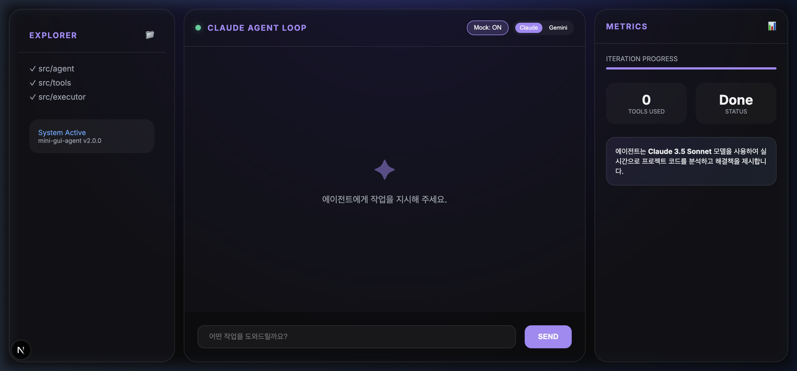

# ✦ Mini-GUI-Agent: AI Engineering Dashboard

[한국어](#-mini-gui-agent-ai-engineering-dashboard) · [English](#english)

현대적이고 미려한 디자인의 대시보드를 통해 **Claude**와 **Google Gemini**기반의 AI 에이전트 루프를 관리하고 모니터링할 수 있는 프로젝트입니다.



## 🚀 주요 특징

- **Dual-Model Support**: Anthropic Claude와 Google Gemini를 모두 지원합니다. 버튼 하나로 에이전트 엔진을 전환할 수 있습니다.
- **Agent Intelligence**: 주어진 작업을 수행하기 위해 디렉토리 분석, 파일 읽기/쓰기, 명령어 실행 등 다양한 도구(Function Calling)를 사용합니다.
- **Modern Dashboard UI**: 사고 과정(Thought), 도구 실행(Tool Use), 결과(Result)를 실시간으로 시각화하여 에이전트의 워크플로우를 한눈에 파악할 수 있습니다.
- **Mock Mode 지원**: API 키 없이도 에이전트의 동작 방식을 테스트할 수 있는 시나리오 기반 시뮬레이션 모드를 제공합니다.
- **Metrics & Logging**: 도구 사용 횟수, 상태 진행도, 상세 실행 로그를 실시간으로 확인 가능합니다.

## 🛠️ 기술 스택

- **Frontend/Backend**: Next.js (App Router), React, TypeScript
- **Styling**: Vanilla CSS (Modern Aesthetics)
- **AI SDK**: @anthropic-ai/sdk, @google/generative-ai
- **Tools**: Zod, Zod-to-JSON-Schema

## 🔧 도구 모음 (Agent Tools)

에이전트는 다음 도구들을 조합하여 복잡한 엔지니어링 작업을 수행합니다:
- `list_dir`: 디렉토리 구조 확인
- `read_file` / `write_file`: 파일 내용 읽기 및 쓰기
- `edit_file`: 파일의 특정 부분 수정 (Linter 기반 보정 포함)
- `run_command`: 터미널 명령어 실행
- `search_code`: 코드베이스 내 검색
- `glob`: 패턴 기반 파일 탐색

## 🏁 시작하기

### 1. 환경 변수 설정
`.env.local` 파일(혹은 시스템 호스트 환경)에 다음 API 키들을 설정해 주세요.

```bash
ANTHROPIC_API_KEY=your_anthropic_key
GEMINI_API_KEY=your_gemini_key
```

### 2. 패키지 설치
```bash
npm install
```

### 3. 개발 서버 실행
```bash
npm run dev
```
이후 `http://localhost:3000`에 접속하여 대시보드를 확인하세요.

## 📁 프로젝트 구조

- `app/`: Next.js 페이지 및 레이아웃 (Dashboard UI)
- `src/agent/`: 에이전트 루프 및 모델별 래퍼 (Claude, Gemini, Mock)
- `src/executor/`: 도구 실행 및 스키마 변환 (ToolExecutor)
- `src/tools/`: 개별 도구 구현체
- `lib/`: 서버 사이드 에이전트 러너

---

## English

Mini-GUI-Agent is an AI engineering dashboard for running and monitoring agent loops powered by Anthropic Claude or Google Gemini.


### Highlights

- Switchable Claude and Gemini engines
- Agent tools for directory inspection, file editing, command execution, code search, and glob matching
- Live visualization of reasoning, tool calls, results, progress, and logs
- Mock mode for trying the workflow without API keys

### Getting started

Create `.env.local`:

```env
ANTHROPIC_API_KEY=your_anthropic_key
GEMINI_API_KEY=your_gemini_key
```

Then run:

```bash
npm install
npm run dev
```

Open [http://localhost:3000](http://localhost:3000).
